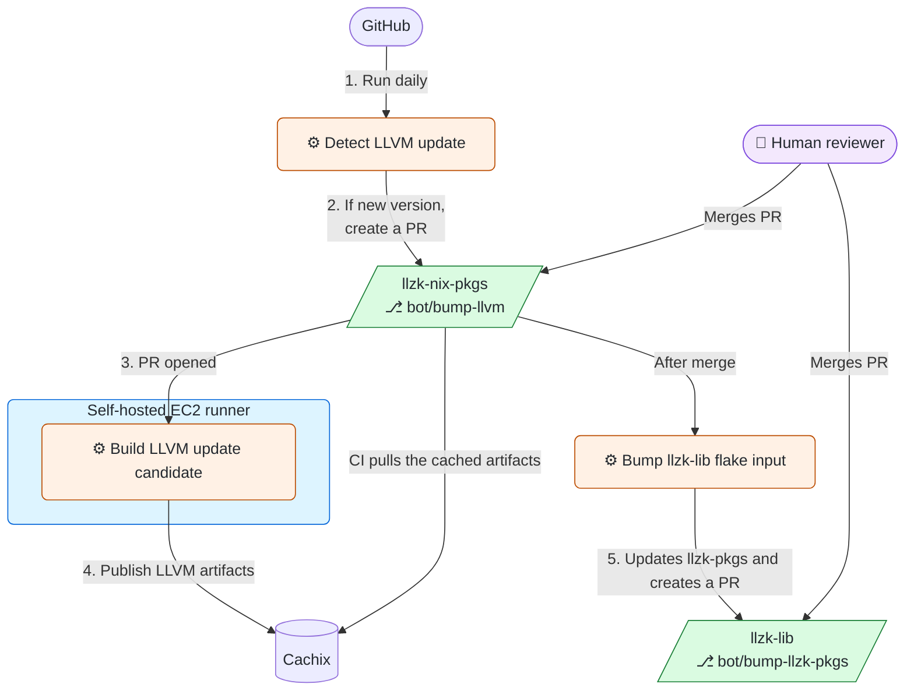

# LLZK Nix Packages

Nix flake containing common packages used by LLZK and in projects using LLZK.

By default, the packages are provided by the `default` overlay of this flake.

## LLVM update automation

Scheduled or manual checks for a newer LLVM version create an update PR.
After the dedicated builder validates it and publishes its artifacts to Cachix,
merging the PR starts a reviewable update of `llzk-lib`'s `llzk-pkgs` input.

### LLVM update builder

LLVM update candidates are built only by the `Build LLVM update candidate`
workflow.  It runs on the dedicated EC2 runner with all of these labels:
`self-hosted`, `linux`, `x64`, and `llzk-llvm-builder`.  The runner must be
available only to this repository and have `bash`, `git`, `gh`, Nix compatible
with this flake, the Cachix client, and sufficient CPU, memory, and disk for
the LLVM builds.  Treat its workspace as sensitive: clean it between jobs or
use an ephemeral/reimaged runner.

Before enabling the workflow, repository administrators must:

- Protect `bot/bump-llvm` with a ruleset that permits updates only from the
  `nix-pkgs-llvm-update-bot` GitHub App.  Do not allow human or other workflow
  bypasses.  The App needs only repository `Contents`, `Pull requests`, and
  `Issues` read/write access, and must be installed only on this repository.
- Create the protected `llvm-update-automation` environment with
  `NIX_PKGS_LLVM_UPDATE_APP_PRIVATE_KEY` and the
  `NIX_PKGS_LLVM_UPDATE_APP_ID` configuration variable.  The private
  key is used only to mint short-lived installation tokens for the update bot.
- Create the protected `llvm-cache-publisher` environment and store the Cachix
  write token there as `CACHIX_PUBLIC_TOKEN`; only the privileged builder job
  may use that environment.
- Create the protected `llzk-lib-update-automation` environment for the
  merge-triggered downstream update.  Create a dedicated GitHub App and put
  its private key in the `LLZK_LIB_UPDATE_APP_PRIVATE_KEY` environment secret
  and its client ID in the `LLZK_LIB_UPDATE_APP_CLIENT_ID` environment
  variable.  Install it only on `project-llzk/llzk-lib` with `Contents` and
  `Pull requests` read/write access.  The workflow mints a short-lived token
  explicitly limited to that repository; it does not receive Cachix or
  LLVM-update credentials.

The privileged workflow is defined on `main` and accepts only an in-repository
`bot/bump-llvm` PR created by `nix-pkgs-llvm-update-bot[bot]`.  It rechecks the
PR head before checkout and rejects candidates whose merge-base diff contains
anything other than `flake.lock` and, for a major LLVM update, `flake.nix`.
Same-major updates change only the lock file; major updates also select the
corresponding `llvmPackages_N` attribute in `flake.nix`. Public and fork PRs
therefore cannot schedule work on the EC2 runner or access Cachix publishing
credentials.

When that trusted LLVM PR is merged, `Bump llzk-lib flake input` creates or
updates the `bot/bump-llzk-pkgs` PR in `project-llzk/llzk-lib`.  It updates only
the downstream lock file and never enables auto-merge; the normal downstream
pull-request workflows and a human reviewer decide whether to merge it.
