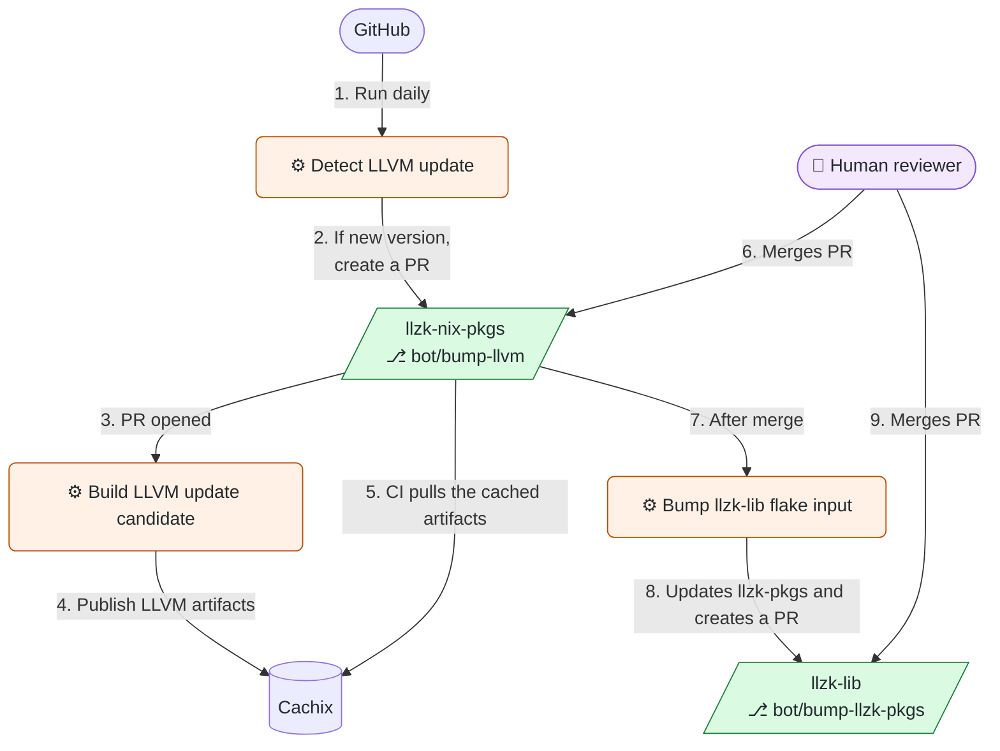

# LLZK Nix Packages

Nix flake containing common packages used by LLZK and in projects using LLZK.

By default, the packages are provided by the `default` overlay of this flake.

The `mlir-with-python` package enables MLIR's nanobind Python bindings. Its
`python` output contains the installed `mlir` package, and `pythonDeps` exposes
the matching Python build dependencies for downstream extensions.

Build and test the installed bindings with:

```sh
nix build -L .#mlir-with-python
nix build -L .#checks.[system].using-mlir-python
```

`nix flake check` also runs this smoke test, which covers dialect registration,
generated operation builders, IR verification, pass execution, and NumPy
attribute conversion.

## LLVM update automation

Scheduled or manual checks for a newer LLVM version create an update PR.
After the dedicated builder validates it and publishes its artifacts to Cachix,
merging the PR starts a reviewable update of `llzk-lib`'s `llzk-pkgs` input.



